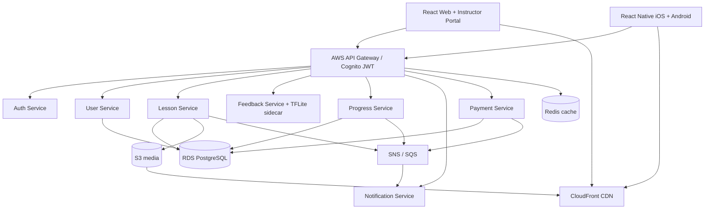

# Proposed Technical Architecture

Source: §§3–4, October 2026 MIH Technical Design Document (draft).

## Client layer
- Responsive React 18 / TypeScript application hosted on Vercel; Tailwind CSS
- React Native iOS and Android clients
- Redux Toolkit for global state and React Query for server state
- Web Audio API / microphone support in browser; native audio capture on mobile
- HTML5 video and `react-native-video` for playback; WebSocket feedback

## Seven microservices
| Service | Responsibility | Interfaces / state |
|---|---|---|
| Auth | Authentication, access tokens, sessions | Cognito; REST |
| User | Profile and roles | PostgreSQL; REST |
| Lesson | Catalog, signed media URLs | PostgreSQL, S3; REST + SNS |
| Feedback | Pitch, rhythm and timing analysis | Stateless + TFLite sidecar; WebSocket |
| Progress | Completion, XP and badges | PostgreSQL; REST + SQS |
| Notification | Email and push messages | SQS/SNS |
| Payment | Stripe checkout, billing lifecycle/webhooks | PostgreSQL, Stripe |

## Infrastructure
- Containers on Amazon ECS Fargate; independently deployable services with domain data isolation
- Amazon RDS PostgreSQL (Multi-AZ), S3 versioned objects and CloudFront signed URLs
- Amazon Cognito and AWS API Gateway for identity, JWT authorization, rate limits and CORS
- Redis/ElastiCache for session and lesson-metadata caching; lesson metadata TTL 300 seconds
- SQS/SNS asynchronous events, Kinesis analytics streaming into Redshift
- CloudWatch logging/metrics/alarms, AWS X-Ray distributed traces

## Feedback pipeline
1. Authenticated lesson session establishes a persistent WebSocket.
2. Client chunks microphone audio into 250 ms PCM frames.
3. Feedback Service performs normalization/noise reduction, invokes co-located TFLite runtime.
4. Scores: pitch (cents deviation), timing (milliseconds), rhythm (beat regularity).
5. Structured JSON scores return on WebSocket for real-time visual overlays.

The document simultaneously mentions **on-device and server-side** ML inference, but details primarily the server-side TFLite sidecar. Confirm the intended model placement before building.

## Service resilience
- Circuit breaker design: 5 failures in 30 seconds; open for 60 seconds
- SQS dead-letter queues after 3 failed deliveries; exponential backoff and jitter
- Signed CloudFront media URL expiration: 3,600 seconds
- ECS service task range: 2–20; 70% CPU scaling target; 60s scale-out/300s scale-in cooldown

Architecture is a *proposed design*, not evidence of provisioned infrastructure. AWS App Mesh is referenced by the source and requires an up-to-date platform review before implementation.
