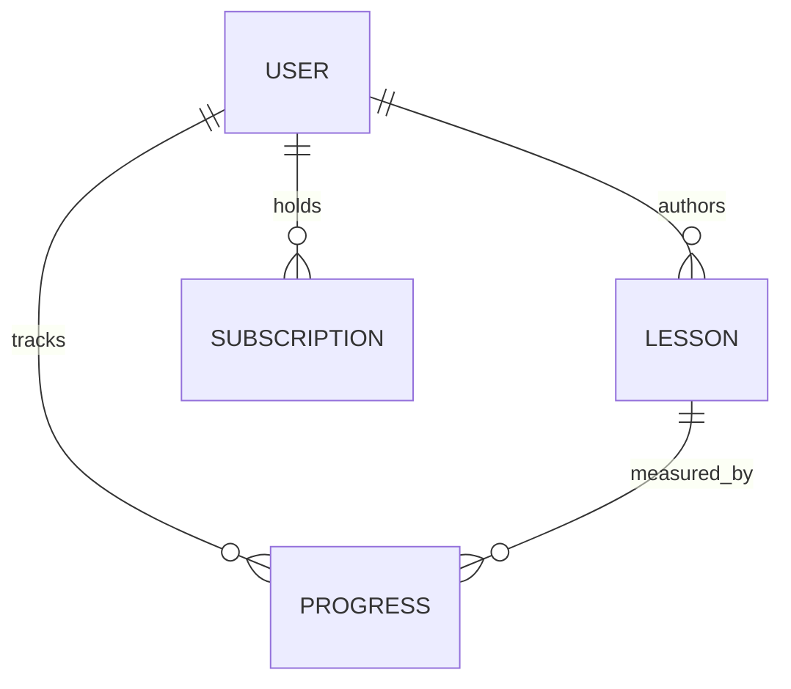

# Proposed Relational Data Models

Source: §6.1 and Appendix B, MIH Technical Design Document (draft v1.0). UUIDv4 application-generated primary keys; UTC timestamps. These tables summarize the document, **not a deployed database**.

## User
| Field | Type / constraint |
|---|---|
| userId | UUID PK |
| email | VARCHAR(320), unique, not null |
| passwordHash | VARCHAR(255), not null in draft; Cognito conflict noted below |
| displayName | VARCHAR(100), not null |
| role | ENUM Learner / Instructor / Admin |
| subscriptionTier | ENUM Free / Premium / Pro, default Free |
| createdAt, updatedAt | TIMESTAMPTZ, not null |

## Lesson
| Field | Type / constraint |
|---|---|
| lessonId | UUID PK |
| title | VARCHAR(255), not null |
| instrument | VARCHAR(100), not null |
| difficulty | ENUM Beginner / Intermediate / Advanced |
| videoUrl | VARCHAR(1024), required S3 object key |
| audioTrackUrl | VARCHAR(1024), nullable S3 key |
| sheetMusicUrl | VARCHAR(1024), nullable S3 key |
| durationSeconds | INTEGER, not null |
| instructorId | UUID FK → User.userId |
| tags | TEXT[], nullable |
| createdAt | TIMESTAMPTZ, not null |

## Progress
| Field | Type / constraint |
|---|---|
| progressId | UUID PK |
| userId | UUID FK → User.userId |
| lessonId | UUID FK → Lesson.lessonId |
| completionPercentage | DECIMAL(5,2), default 0; 0–100 |
| pitchAccuracyScore | DECIMAL(5,2), nullable 0–100 |
| timingScore | DECIMAL(5,2), nullable 0–100 |
| attemptCount | INTEGER, default 0 |
| lastAttemptAt | TIMESTAMPTZ, nullable |
| badgesEarned | TEXT[], nullable |

## Subscription
| Field | Type / constraint |
|---|---|
| subscriptionId | UUID PK |
| userId | UUID FK → User.userId |
| plan | ENUM Free / Premium / Pro |
| stripeSubscriptionId | VARCHAR(255), nullable for Free |
| status | ENUM active / past_due / cancelled / trialing |
| startDate | DATE, not null |
| renewalDate | DATE, nullable |

## Conceptual entity relationships

## Unresolved modeling concerns
1. The source states no microservice should share a database schema, yet uses cross-domain foreign keys to `User` and `Lesson`. Decide whether those relationships are enforced inside one DB or managed as external IDs across services.
2. `passwordHash` is required in the User record even though Amazon Cognito owns credentials. Clarify identity and password-storage responsibilities.
3. Define subscription entitlement consistency, currency/pricing and webhook idempotency.
4. Clarify unique constraints on user+lesson progress, and whether history is required beyond the most recent attempt.

Avoid producing SQL migrations before these questions are resolved.
